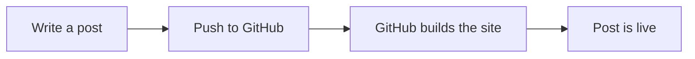

This is the first post on f8idea. It also works as a reference: every kind of content a post can hold appears below, so you can see how each one looks.

## Writing a post

Each post is one Markdown file in the `_posts` folder. The file name carries the date and the address of the post:

```text
_posts/2026-11-15-hello-world.md
```

A short block at the top of the file sets the title and the one-line summary shown under it:

```yaml
---
title: Hello, world
description: The first post on f8idea.
---
```

Everything after that block is the post itself. Commit the file, push, and the post is live about a minute later.

## Text

Paragraphs are plain text. You can make words **bold** or *italic*, link to [another page](https://docs.github.com/en/pages), and mark `inline code` with backticks.

> A block quote sets a passage apart: a line worth remembering, or someone else's words.

Lists come in two kinds:

- Bulleted, for items in no particular order
- Like this one

1. Numbered, for steps
2. That happen in sequence

## Code

Code blocks are colored by language. Name the language after the opening backticks:

```rust
/// Returns the n-th Fibonacci number.
fn fib(n: u32) -> u64 {
    let (mut a, mut b) = (0, 1);
    for _ in 0..n {
        (a, b) = (b, a + b);
    }
    a
}

fn main() {
    println!("fib(10) = {}", fib(10)); // prints 55
}
```

## Math

Formulas are written in LaTeX between double dollar signs. Inside a sentence they stay inline, like $$e^{i\pi} + 1 = 0$$. On lines of their own they are centered:

$$
\int_{-\infty}^{\infty} e^{-x^2}\,dx = \sqrt{\pi}
$$

The source of the two formulas above:

~~~text
Inside a sentence they stay inline, like $$e^{i\pi} + 1 = 0$$.

$$
\int_{-\infty}^{\infty} e^{-x^2}\,dx = \sqrt{\pi}
$$
~~~

## Diagrams

A code block marked `mermaid` is drawn as a diagram:



Its source:

~~~text

~~~

## Tables

| Markdown | Result |
| --- | --- |
| `**bold**` | **bold** |
| `*italic*` | *italic* |
| `[text](url)` | a link |

### Smaller headings

A third-level heading like the one above splits a long section into parts.
